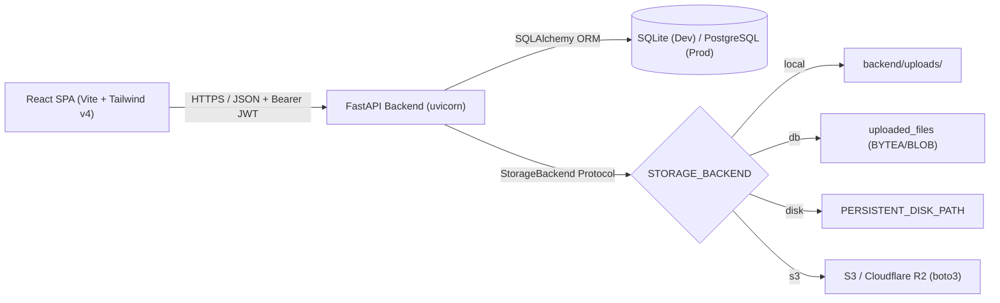
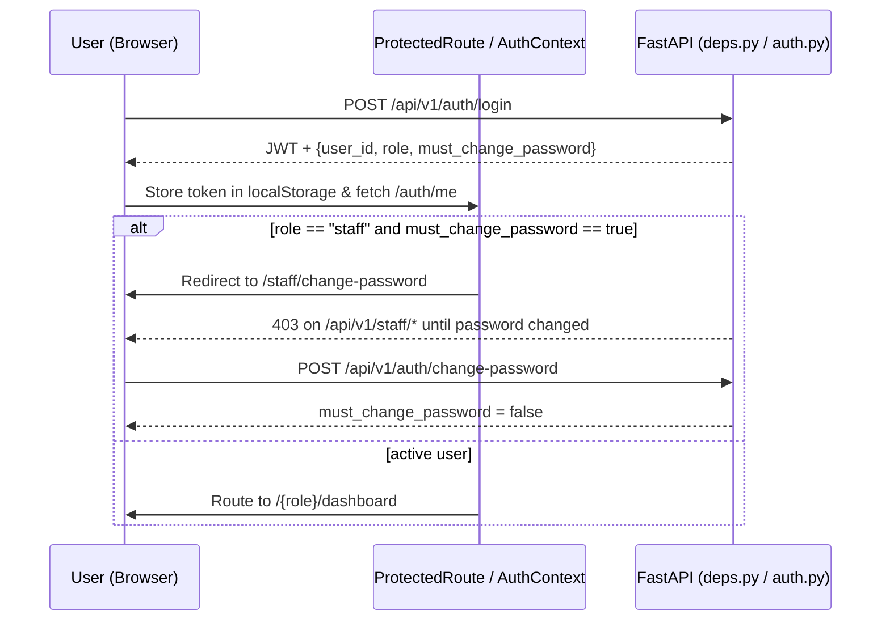
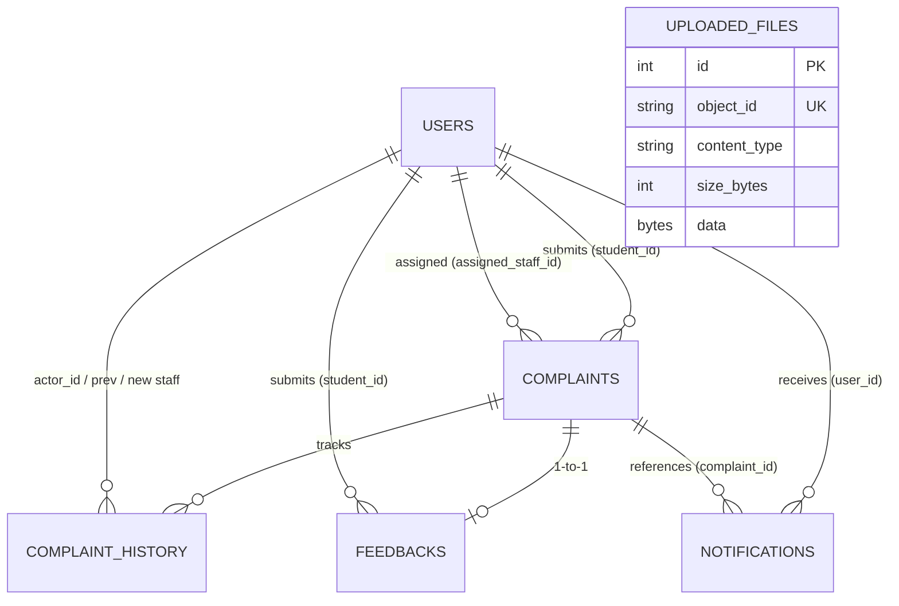

# CampusFix — System Architecture

**Status:** Active Master Reference  
**Source of Truth:** CampusFix Repository (`main` branch, commit `89675da`)  
**Last Verified:** 2026-11-28

---

## 1. High-Level System Architecture

CampusFix is a decoupled client–server web application consisting of a React Single-Page Application (SPA) frontend and a FastAPI REST API backend backed by SQLAlchemy + Alembic and a pluggable attachment storage layer.

---

## 2. Technology Stack

| Layer | Technology | Version / Notes (Verified in Repo) |
| :--- | :--- | :--- |
| **Frontend Framework** | React + React Router | `react` `^19.2.8`, `react-router-dom` `^7.18.2` |
| **Frontend Build & Lint** | Vite + Tailwind CSS v4 + oxlint | `vite` `^8.2.0`, `@tailwindcss/vite` `^4.3.3`, `oxlint` `^1.75.0` |
| **Icons** | Lucide React | `lucide-react` `^1.33.0` |
| **Backend Framework** | FastAPI + Uvicorn | `fastapi[all]==0.111.0` (`backend/requirements.txt`) |
| **ORM & Migrations** | SQLAlchemy + Alembic | `sqlalchemy>=2.0.35`, `alembic==1.13.1` |
| **Database Drivers** | SQLite (stdlib) / `pg8000` | `pg8000==1.31.2`, `scramp==1.4.18` |
| **Auth & Crypto** | `python-jose` + `passlib[bcrypt]` | `python-jose[cryptography]==3.3.0`, `passlib[bcrypt]==1.7.4`, `bcrypt==4.0.1` |
| **Image Processing** | Pillow | `pillow>=11.0.0` |
| **Object Storage** | `boto3` | `boto3>=1.35.0` |

---

## 3. Module Responsibilities

### 3.1 Backend (`backend/`)
- **`main.py`:** Initializes `FastAPI(title="CampusFix API")`, configures `CORSMiddleware` from `settings.cors_origins`, mounts 6 routers under `/api/v1/*`, and exposes health/welcome `GET /`.
- **`core/config.py`:** `pydantic-settings` `Settings` class loading `.env`; normalizes `postgres://` and `postgresql://` URLs to `postgresql+pg8000://`; exposes `cors_origins` and storage config.
- **`core/security.py`:** Bcrypt hashing/verification (`CryptContext`) and HS256 JWT creation (`create_access_token`).
- **`db/database.py`:** Creates SQLAlchemy `engine`, `SessionLocal`, `Base`, and `get_db()` dependency.
- **`api/deps.py`:** OAuth2 bearer extraction (`oauth2_scheme`), `get_current_user` (validates JWT, `is_active`, and `account_status == "active"`), and role guards (`require_admin`, `require_staff` with `must_change_password` check, `require_student`).
- **`api/routers/`:**
  - `auth.py`: Login, disabled registration (`403`), `/me` read/update, `/change-password`.
  - `complaints.py`: Student complaint CRUD, feedback/closure, history.
  - `staff.py`: Assigned complaint listing/details, status state machine, history.
  - `admin.py`: All complaints, assignment/unassignment, priority updates, staff listing/activation, history, analytics.
  - `upload.py`: Bounded streaming upload, magic-byte + Pillow sanitization, authorized file retrieval.
  - `notifications.py`: User notification feed, unread count, mark read / read all.
- **`services/`:**
  - `notification_service.py`: DB notification creation and read-state updates.
  - `storage_service.py`: `StorageBackend` protocol and 4 implementations (`LocalStorageBackend`, `DatabaseStorageBackend`, `PersistentDiskStorageBackend`, `S3StorageBackend`).
- **Operational CLI Scripts:** `admin_bootstrap.py`, `staff_bootstrap.py`, `check_staff_counts.py`, `create_demo_users.py` (dev only).

### 3.2 Frontend (`frontend/src/`)
- **`api/`:** `client.js` (Fetch wrapper injecting `Authorization: Bearer <token>` from `localStorage`, handling JSON/FormData and FastAPI `detail` errors) + domain modules (`admin.js`, `complaints.js`, `notifications.js`, `staff.js`, `upload.js`).
- **`context/AuthContext.jsx`:** Holds `user` and `loading` state, initializes session via `GET /api/v1/auth/me`, handles `login`, `logout`, `updateProfile`, `changePassword`.
- **`components/layout/`:** `AppLayout.jsx`, `Sidebar.jsx`, `TopBar.jsx`, `ProtectedRoute.jsx` (role + `must_change_password` enforcement), `NotificationDropdown.jsx`.
- **`components/ui/`:** Reusable primitives (`Alert`, `Badge`, `Button`, `Card`, `Input`, `PriorityBadge`, `Spinner`, `StatusBadge`, `ActivityTimeline`).
- **`components/ComplaintAttachment.jsx`:** Fetches protected `/api/v1/upload/files/{object_id}` via `fetch` with `Bearer` token and renders via `URL.createObjectURL`.
- **`pages/`:** Role-scoped views under `auth/`, `student/`, `staff/`, `admin/`, and `shared/Profile.jsx`.
- **`utils/`:** `categories.js` (category label mapping and `CATEGORY_OPTIONS`).

---

## 4. API Architecture

All domain endpoints are mounted under `/api/v1`:

| Prefix | Router | Key Endpoints |
| :--- | :--- | :--- |
| `/api/v1/auth` | `auth.py` | `POST /register` (403), `POST /login`, `GET /me`, `PATCH /me`, `POST /change-password` |
| `/api/v1/complaints/student` | `complaints.py` | `POST /`, `GET /`, `GET /{id}`, `POST /{id}/feedback`, `GET /{id}/feedback`, `GET /{id}/history` |
| `/api/v1/staff` | `staff.py` | `GET /complaints`, `GET /complaints/{id}`, `PATCH /complaints/{id}/status`, `GET /complaints/{id}/history` |
| `/api/v1/admin` | `admin.py` | `GET /complaints`, `GET /complaints/{id}`, `PATCH /complaints/{id}/assign`, `PATCH /complaints/{id}/priority`, `GET /staff`, `PATCH /staff/{id}/activate`, `GET /complaints/{id}/history`, `GET /analytics` |
| `/api/v1/upload` | `upload.py` | `POST /`, `GET /files/{object_id}` |
| `/api/v1/notifications` | `notifications.py` | `GET /`, `GET /unread-count`, `PATCH /{id}/read`, `PATCH /read-all` |

---

## 5. Authentication & Authorization Architecture

- **Token Storage:** `localStorage.getItem('token')` (`AuthContext.jsx`, `client.js`, `ComplaintAttachment.jsx`).
- **JWT Claims:** `sub` (string user ID), `role` (`student` | `staff` | `admin`), `exp` (7 days).
- **Authorization Checks:**
  - `get_current_user`: Rejects missing/invalid JWT, `is_active == False`, or `account_status != "active"`.
  - `require_staff`: Additionally rejects `must_change_password == True` with `HTTP 403`.
  - File downloads (`GET /api/v1/upload/files/{object_id}`): Explicitly checks `admin` OR `complaint.student_id == current_user.id` OR `complaint.assigned_staff_id == current_user.id`.

---

## 6. Database Architecture & Relationships

**Alembic Migration Chain (`backend/alembic/versions/`):**
1. `4dcb038e44f3` — `create_user_table`
2. `951b04afe8c3` — `create_complaint_table`
3. `6099a5b14078` — `add_assigned_staff_id`
4. `3dc824816e82` — `add_resolution_note`
5. `4a9f7adc7718` — `add_feedback`
6. `9cd931942e54` — `add_notifications_table`
7. `5bddc1131563` — `add_complaint_history`
8. `a7c4e9b21f10` — `add_uploaded_files_table`
9. `b8e2f4c19a30` — `add_staff_metadata_and_activation_fields` *(current head)*

**Complaint–Upload Relationship:** `Complaint.image_url` stores the retrieval URL referencing `/api/v1/upload/files/{object_id}`. This is a **soft linkage** rather than a database Foreign Key: `backend/api/routers/upload.py` resolves ownership by matching `Complaint.image_url.endswith(f"/{object_id}")`, and `uploaded_files.object_id` is used to identify the stored binary object when `STORAGE_BACKEND=db`.

---

## 7. File Storage Architecture

`backend/services/storage_service.py` selects a backend via `STORAGE_BACKEND`:
- `local` (default): Writes to `backend/uploads/`. Explicitly blocked when `RENDER` env var is set.
- `db`: Stores sanitized image bytes in `uploaded_files` table (`LargeBinary` / PostgreSQL `BYTEA`).
- `disk`: Writes to `PERSISTENT_DISK_PATH` (validated absolute path, e.g., Render Persistent Disk).
- `s3`: Uses `boto3` for AWS S3 / Cloudflare R2 / MinIO (`S3_BUCKET_NAME`, `S3_ENDPOINT_URL`, `S3_REGION`, `S3_PREFIX`).

All uploads pass through `_read_upload_bounded` (5 MB max, 64 KB chunks), `_detect_image_format` (magic bytes), and `_validate_and_sanitize_image` (Pillow `verify()` + re-save stripping EXIF, 25 MP pixel limit).

---

## 8. Integration & Deployment Architecture

- **External Integrations:** Optional S3-compatible object storage (`boto3`). No email, SMS, or SSO providers are integrated (`NOT IMPLEMENTED`).
- **Deployment Target (Evidence from `config.py`, `.env.example`, `storage_service.py`, `check_staff_counts.py`):**
  - Backend: Render Web Service + Render PostgreSQL (`pg8000` with SSL context when `render.com` or `sslmode` is present in `check_staff_counts.py`; `STORAGE_BACKEND=db`, `disk`, or `s3`).
  - Frontend: Static SPA built with `npm run build` (`vite build`), configured via `VITE_API_URL`.
  - *Note:* No `render.yaml`, `Dockerfile`, or CI/CD workflow files exist in the repository (`NOT IMPLEMENTED` / configured via platform dashboard — `NEEDS VERIFICATION`).

---

## 9. Scalability & Maintainability Strategy

- **Current Strengths:** Clean router/service/schema separation, Alembic migrations, pluggable `StorageBackend` protocol, comprehensive `pytest` suite (130 tests).
- **Known Scaling Constraints:**
  - `STORAGE_BACKEND=db` stores binary blobs in PostgreSQL (subject to Render Free 1 GB cap); `s3` or `disk` should be used for high attachment volume.
  - `GET /api/v1/complaints/student/`, `/staff/complaints`, and `/admin/complaints` lack pagination (`skip`/`limit` on student/staff).
  - Notification polling (60s interval) scales linearly with active sessions; SSE/WebSockets would reduce idle polling at scale.
